

<picture>
  <source media="(prefers-color-scheme: dark)" srcset=".github/brand/banner-night.svg">
  
</picture>
  
<a href="#about"><picture><source media="(prefers-color-scheme: dark)" srcset=".github/brand/tab-about-night.svg"></picture></a>
<a href="#stack"><picture><source media="(prefers-color-scheme: dark)" srcset=".github/brand/tab-stack-night.svg"></picture></a>
<a href="#projects"><picture><source media="(prefers-color-scheme: dark)" srcset=".github/brand/tab-projects-night.svg"></picture></a>
<a href="#stats"><picture><source media="(prefers-color-scheme: dark)" srcset=".github/brand/tab-stats-night.svg"></picture></a>
<a href="#contact"><picture><source media="(prefers-color-scheme: dark)" srcset=".github/brand/tab-contact-night.svg"></picture></a>

 

<a href="https://linkedin.com/in/NoamFavier">linkedin</a> &nbsp;·&nbsp;
<a href="https://stackoverflow.com/users/24497800">stack overflow</a> &nbsp;·&nbsp;
<a href="https://nf-software.com">nf-software.com</a> &nbsp;·&nbsp;
<a href="mailto:noamfav@nf-software.com">noamfav@nf-software.com</a>

Data Science & AI student at Maastricht, building tomorrow's technology today. Systems in
Rust and C++, apps in Swift and Kotlin, models in PyTorch, and game engines of my own.

<picture><source media="(prefers-color-scheme: dark)" srcset=".github/brand/section-about-night.svg"></picture>

<picture>
  <source media="(prefers-color-scheme: dark)" srcset=".github/brand/term-mission-night.svg">
  
</picture>

**Fun fact.** Building Iron Man tech isn't just a dream, it's the roadmap. Next level:
revolutionizing robotics with AI integration.

<table>
<tr><th align="left">achievements unlocked</th><th align="left"></th></tr>
<tr><td>studying</td><td>Data Science & AI @ Maastricht</td></tr>
<tr><td>programming</td><td>4+ years</td></tr>
<tr><td>hackathons</td><td>Multiple wins</td></tr>
<tr><td>stacks</td><td>15+ mastered</td></tr>
<tr><td>open source</td><td>Contributor</td></tr>
<tr><td>research</td><td>AI/ML papers</td></tr>
</table>

<picture><source media="(prefers-color-scheme: dark)" srcset=".github/brand/section-stack-night.svg"></picture>

<picture>
  <source media="(prefers-color-scheme: dark)" srcset=".github/brand/term-stack-night.svg">
  
</picture>

<picture><source media="(prefers-color-scheme: dark)" srcset=".github/brand/section-projects-night.svg"></picture>

<a href="https://github.com/NoamFav/Zvezda"><picture><source media="(prefers-color-scheme: dark)" srcset=".github/brand/card-zvezda-night.svg"></picture></a>
<a href="https://github.com/NoamFav/Nvim-config"><picture><source media="(prefers-color-scheme: dark)" srcset=".github/brand/card-nvim-config-night.svg"></picture></a>
<a href="https://github.com/NoamFav/Zarya.nvim"><picture><source media="(prefers-color-scheme: dark)" srcset=".github/brand/card-zarya-nvim-night.svg"></picture></a>

<a href="https://github.com/NoamFav/ShadowedHunter"><picture><source media="(prefers-color-scheme: dark)" srcset=".github/brand/card-shadowedhunter-night.svg"></picture></a>
<a href="https://github.com/NoamFav/Pot_Pot_Golf"><picture><source media="(prefers-color-scheme: dark)" srcset=".github/brand/card-pot-pot-golf-night.svg"></picture></a>
<a href="https://github.com/NoamFav/BitVoyager"><picture><source media="(prefers-color-scheme: dark)" srcset=".github/brand/card-bitvoyager-night.svg"></picture></a>

<picture><source media="(prefers-color-scheme: dark)" srcset=".github/brand/section-stats-night.svg"></picture>

<picture><source media="(prefers-color-scheme: dark)" srcset="https://github-stats-extended.vercel.app/api?username=NoamFav&show_icons=true&count_private=true&include_all_commits=true&bg_color=0a0b0d&title_color=c5f269&text_color=eae7e0&icon_color=c5f269&ring_color=c5f269&border_color=282c32&border_radius=10"></picture>
<picture><source media="(prefers-color-scheme: dark)" srcset="https://github-readme-streak-stats.herokuapp.com/?user=NoamFav&background=0a0b0d&border=282c32&stroke=282c32&ring=c5f269&fire=c5f269&currStreakNum=eae7e0&sideNums=eae7e0&currStreakLabel=c5f269&sideLabels=8e9299&dates=565a62&border_radius=10"></picture>

<picture><source media="(prefers-color-scheme: dark)" srcset="https://github-stats-extended.vercel.app/api/top-langs/?username=NoamFav&layout=compact&langs_count=8&count_private=true&bg_color=0a0b0d&title_color=c5f269&text_color=eae7e0&border_color=282c32&border_radius=10"></picture>

<picture><source media="(prefers-color-scheme: dark)" srcset="https://github-profile-trophy.screw-hand.vercel.app/?username=NoamFav&theme=onedark&no-frame=true&no-bg=true&column=7&margin-w=15&margin-h=15"></picture>

<picture>
  <source media="(prefers-color-scheme: dark)" srcset="https://raw.githubusercontent.com/NoamFav/NoamFav/output/github-contribution-grid-snake-dark.svg">
  
</picture>

<b>random dev wisdom</b> · a new one every visit

 

<picture><source media="(prefers-color-scheme: dark)" srcset="https://quotes-github-readme.vercel.app/api?type=horizontal&theme=dark"></picture>

<!--
  spotify-github-profile's demo instance now returns "Payment required" (DEPLOYMENT_DISABLED).
  To bring this back: fork https://github.com/novatorem/spotify-github-profile, deploy your own
  Vercel instance with your own Spotify API client id/secret + refresh token (their README has
  the full setup), then restore this block pointing at your own deployment URL:

  
-->

<picture><source media="(prefers-color-scheme: dark)" srcset=".github/brand/section-contact-night.svg"></picture>

<table>
<tr><th align="left">where</th><th align="left"></th></tr>
<tr><td>email</td><td><a href="mailto:noamfav@nf-software.com">noamfav@nf-software.com</a></td></tr>
<tr><td>linkedin</td><td><a href="https://linkedin.com/in/NoamFavier">in/NoamFavier</a></td></tr>
<tr><td>stack overflow</td><td><a href="https://stackoverflow.com/users/24497800">users/24497800</a></td></tr>
<tr><td>github</td><td><a href="https://github.com/NoamFav">NoamFav</a></td></tr>
</table>

Thanks for visiting. Feel free to star the repos, and let's build something amazing together.

 

<a href="https://nf-software.com">
<picture>
  <source media="(prefers-color-scheme: dark)" srcset=".github/brand/footer-night.svg">
  
</picture>
</a>

<!-- Hidden Metrics -->
<!--

  

-->
